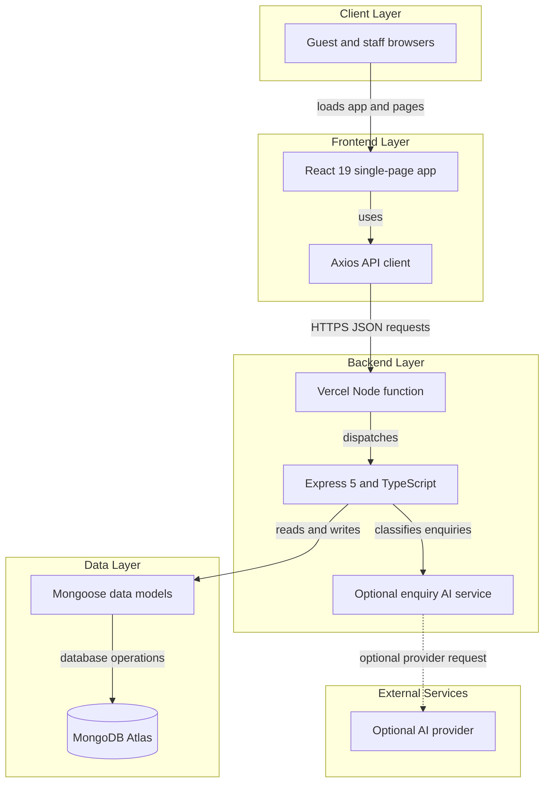
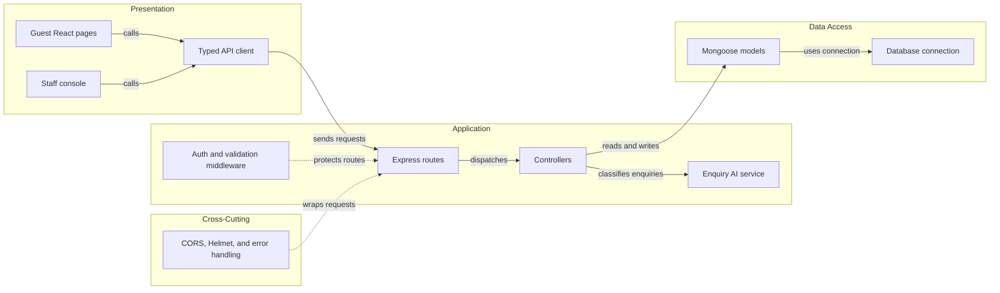

# Architecture Diagram

EstateStay is a React single-page application backed by an Express API and
MongoDB Atlas. The API also supports optional AI-assisted enquiry triage.

## Application Architecture

<!-- mermaid-checked: no \n, no em-dash/en-dash, no {} in labels, subgraphs are id["label"], arrows are -->|"label"|, all subgraphs closed by end, ids unique -->

### Technology Stack Summary

| Layer | Technology | Version | Purpose |
|---|---|---|---|
| Client | React | 19 | Guest and staff interface |
| Client | React Router | 7 | Client-side navigation |
| Build and styling | Vite, Tailwind CSS | 8, 4 | Frontend build and responsive styling |
| API | Node.js, Express | 20+, 5 | HTTP API and serverless request handling |
| API language and validation | TypeScript, Zod | 5.9 backend, 4 | Typed implementation and request validation |
| Persistence | MongoDB Atlas, Mongoose | Managed, 9 | Operational document storage and data access |
| Hosting | Vercel | Managed | Frontend delivery and API function hosting |
| Optional AI | OpenAI or Gemini provider | Configured | Enquiry classification and reply draft generation |

### Data Storage & External Services

MongoDB Atlas is the system of record for users, rooms, plans, daily rates,
allotments, bookings, payments, promotions, and enquiries. Mongoose provides
schema validation and indexed access. The backend may call a configured AI
provider for enquiry assistance; deterministic local classification is
available when AI is disabled or unavailable. The browser does not connect to
the database or receive provider credentials.

### Key Architectural Decisions

- The frontend and backend are independently deployable while sharing one
  repository.
- A modular monolith keeps booking and inventory operations in one API without
  distributed-service overhead.
- AI is optional and isolated from availability and booking decisions.

## Component Relationships

<!-- mermaid-checked: no \n, no em-dash/en-dash, no {} in labels, subgraphs are id["label"], arrows are -->|"label"|, all subgraphs closed by end, ids unique -->

### Component Inventory

| Component | Layer | Type | Responsibility |
|---|---|---|---|
| Guest pages | Presentation | React pages and components | Home, rooms, booking, confirmation, account bookings, and privacy views |
| Staff console | Presentation | React admin components | Staff dashboard and operational management screens |
| Typed API client | Presentation | Axios services | Sends typed requests to the backend API |
| Express routes | Application | Router modules | Mounts health, auth, catalogue, booking, enquiry, and staff endpoints |
| Controllers | Application | Request handlers | Orchestrates API behavior and persistence operations |
| Auth and validation middleware | Application | Express middleware | Validates payloads and protects routes with JWT and role checks |
| Enquiry AI service | Application | Backend service | Classifies enquiries, extracts structured details, and creates unsent drafts |
| Mongoose models | Data Access | ODM models | Define persisted entities, constraints, and indexes |
| Database connection | Data Access | Connection module | Establishes and reuses the process-local MongoDB connection |
| CORS, Helmet, and error handling | Cross-Cutting | Express middleware | Applies browser-origin policy, security headers, logging, and error responses |
