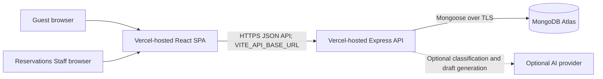
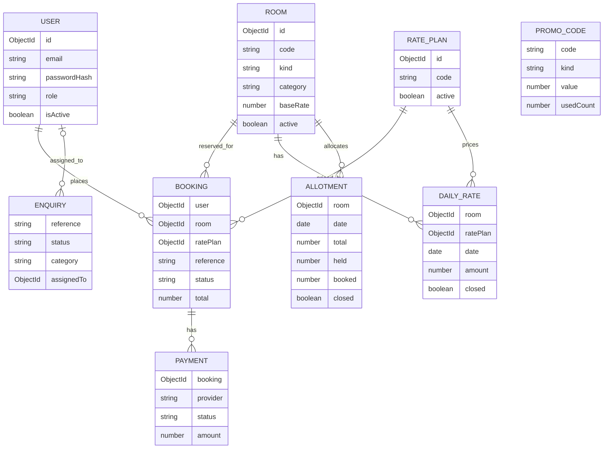

# EstateStay — Technical Design Document

**GitHub repository:** [kartikay-k/Estate-resort-Booking](https://github.com/kartikay-k/Estate-resort-Booking)

**Live application:** [https://estate-resort-booking-jind.vercel.app](https://estate-resort-booking-jind.vercel.app)

**Live API health:** [https://estate-resort-booking.vercel.app/api/health](https://estate-resort-booking.vercel.app/api/health)

| Document control | Value |
|---|---|
| Version | 1.0 |
| Status | As-built architecture with production recommendations |
| Last reviewed | 2026-11-07 |
| System | EstateStay resort booking and operations application |
| Audience | Engineering, operations, security, and product stakeholders |

## 1. Purpose and scope

This document describes the EstateStay application as implemented in this
repository: its user-facing experience, API, persistence model, request flows,
security controls, deployment shape, and operational constraints. It records
recommendations separately from existing behavior.

The system supports a resort catalogue, date-based availability and pricing,
guest accounts and bookings, an operations console for Reservations Staff, and
guest enquiries with optional AI-assisted classification and reply drafting.
The current payment flow is a test/manual flow; a production payment-provider
integration is not implemented.

This document is not a promise of regulatory, tax, availability, or payment
compliance. Validate business rules with the resort's legal, finance, and
operations owners before accepting real customer bookings.

## 2. System context

The frontend is a static single-page application. The backend is an Express
application exported from [`backend/app.ts`](../backend/app.ts) and bundled by Vercel as a
serverless function. MongoDB Atlas is the system of record. The frontend calls
the API directly; it does not access MongoDB or AI-provider credentials.

Primary source anchors:

- Frontend: [`frontend/src/router.tsx`](../frontend/src/router.tsx),
  [`frontend/src/services/api.ts`](../frontend/src/services/api.ts),
  [`frontend/src/services/estateApi.ts`](../frontend/src/services/estateApi.ts).
- Backend entry and routing: [`backend/app.ts`](../backend/app.ts),
  [`backend/server.ts`](../backend/server.ts),
  [`backend/routes/index.ts`](../backend/routes/index.ts).
- Persistence: [`backend/models/`](../backend/models/) and
  [`backend/config/db.ts`](../backend/config/db.ts).

## 3. Architecture

### 3.1 Components and responsibilities

| Component | Responsibility | Key implementation |
|---|---|---|
| Guest web application | Resort pages, catalogue, booking search, guest booking flows, enquiry submission | React 19, React Router 7, Vite 8, TypeScript |
| Staff console | Staff login, analytics, bookings, enquiries, rooms, rates, inventory, promotions | React pages under [`frontend/src/components/admin/`](../frontend/src/components/admin/) and [`frontend/src/pages/Admin/`](../frontend/src/pages/Admin/) |
| HTTP API | Authentication, validation, business rules, booking and operations endpoints | Express 5, TypeScript, Zod |
| Domain persistence | Accounts, catalogue, availability, bookings, payments, enquiries, promotions | MongoDB Atlas accessed through Mongoose |
| Optional AI service | Enquiry classification and unsent reply drafts | [`backend/services/enquiryAi.service.ts`](../backend/services/enquiryAi.service.ts); provider is configurable and can be off |
| Deployment platform | Static frontend delivery and serverless API execution | Vercel; [`frontend/vercel.json`](../frontend/vercel.json) provides SPA fallback rewrites |

The backend separates HTTP routes, controllers, validation/authentication
middleware, Mongoose models, shared utilities, and the optional AI service. The
current implementation is a modular monolith: controllers contain much of the
business orchestration, with no separate service or repository layer for every
domain.

### 3.2 Request path

1. The browser loads the SPA and client-side routes resolve in React Router.
2. The Axios instance uses the build-time `VITE_API_BASE_URL`, normally ending
   in `/api`, and applies a 10-second request timeout.
3. Vercel invokes the Express app exported from
   [`backend/app.ts`](../backend/app.ts).
4. Express applies CORS, Helmet, JSON/form parsing, and request logging.
5. API middleware calls the shared `connectDatabase()` function. Concurrent
   requests in one warm process share an in-flight connection attempt. If the
   database is unavailable, the health route remains diagnostic and
   database-backed routes return `503 Database unavailable`.
6. Route middleware validates input, authenticates the bearer token where
   required, applies role checks for staff operations, then invokes a
   controller.
7. Controllers read/write MongoDB through Mongoose and return a consistent
   JSON response envelope.

The database connection is process-local and may be reused by warm serverless
instances; it is not a cross-instance connection pool or distributed lock.

### 3.3 Deployment topology

| Environment | Frontend | Backend | Database |
|---|---|---|---|
| Local development | Vite dev server, normally `http://localhost:5173` | `tsx watch server.ts`, normally `http://localhost:5001` | Local MongoDB or Atlas URI supplied through the backend environment |
| Hosted | Vercel static SPA | Vercel Node/Express function rooted at `backend` | MongoDB Atlas |
| Alternative template | Not applicable | [`render.yaml`](../render.yaml) describes a Render Node web service | MongoDB Atlas or another reachable MongoDB deployment |

The frontend API base URL is embedded at build time. Changing a Vercel
environment variable therefore requires a new frontend deployment. The API's
`CLIENT_URL` is an allowlist of browser origins, not an API URL. Configure it
with the deployed frontend origin; add the local frontend origin only when
local-browser testing is needed.

### 3.4 Why this architecture

- **React and TypeScript on the client** support a responsive, interactive
  booking experience while keeping API integration typed.
- **Express and TypeScript as a modular monolith** keep booking and inventory
  rules in one deployable API, with clear boundaries between routes,
  controllers, middleware, models, and external AI integration. This fits the
  current team and feature scope without distributed-service overhead.
- **MongoDB with Mongoose** stores operational records as separate collections
  while allowing catalogue and enquiry data to evolve. Explicit date-keyed
  rates and allotments support nightly pricing and inventory checks.
- **Vercel for the SPA and API, with Atlas for persistence** provides a
  low-operations deployment path. The frontend and backend deploy separately,
  and the browser never receives database or AI credentials.
- **Optional AI behind a backend service boundary** allows enquiry assistance
  to be disabled or replaced without making booking dependent on an AI provider.

## 4. Functional design

### 4.1 Guest experience

- Browse active rooms and villas with pagination and optional kind/category
  filters.
- Search dated availability using guest counts and optional stay type.
- View daily rates and rate plans for an accommodation.
- Register or sign in as a guest, create and review bookings, apply promotions,
  request cancellation, and look up a booking using its reference and email.
- Submit an enquiry with privacy consent and optional stay/budget information.

The catalogue is not itself proof of sellable inventory. Availability requires
dated `Allotment` and `DailyRate` records.

### 4.2 Staff experience

Only authenticated users with role `reservations_staff` can access the staff
API. The console provides operational views and actions for:

- Booking search, status management, analytics, and CSV export.
- Enquiry triage, classification, department assignment, and reply drafting.
- Room catalogue management.
- Daily rate and allotment maintenance, including date blackouts.
- Promotion and rate-plan management.

The current role model does not define separate fine-grained permissions for
departments; Reservations Staff share the same staff authorization role.

### 4.3 UI and design decisions

| Screen or area | Design choice | Rationale |
|---|---|---|
| Home | A cinematic hero and date-search entry point lead into featured villas, experiences, events, testimonials, and an enquiry section. | Establishes the estate setting first, then offers clear paths for stays and event enquiries. |
| Rooms and villas | A dark collection header, live search summary, room/villa filters, image-led residence cards, and pagination organize the catalogue. | Helps guests compare accommodation types while keeping date-specific availability and nightly pricing visible. |
| Booking and confirmation | The booking path carries the selected stay into a focused reservation flow, with a confirmation view for the resulting booking. | Keeps the core task focused and gives guests a clear post-submission state. |
| My bookings and privacy | Dedicated account booking and privacy routes are separated from catalogue browsing. | Makes guest reservation access and privacy information discoverable without crowding the home page. |
| Staff console | Operational dashboard sections cover bookings, enquiries, rooms, rates, allotments, promotions, and analytics. | Gives Reservations Staff one place to manage daily operations rather than exposing internal controls in guest navigation. |
| Shared visual system | Evergreen, gilded-sand, and warm-stone tokens pair Fraunces display typography with Inter body text; reusable cards, buttons, form controls, and motion patterns provide consistency. | Creates a calm hospitality identity, preserves readable controls, and keeps interaction patterns coherent across guest and staff flows. |

The interface uses responsive layouts, loading and retry states, and a shared
component layer. The visual system is defined in
[`frontend/src/index.css`](../frontend/src/index.css); routes are declared in
[`frontend/src/router.tsx`](../frontend/src/router.tsx).

### 4.4 API surface

All routes below are prefixed with `/api`. The authoritative route wiring is
[`backend/routes/index.ts`](../backend/routes/index.ts).

| Area | Routes | Access |
|---|---|---|
| Health | `GET /health` | Public; reports process and database state |
| Authentication | `POST /auth/register`, `POST /auth/login`, `GET /auth/me` | Register/login public; `/me` requires bearer token |
| Catalogue and pricing | `GET /rooms`, `GET /rooms/:id`, `GET /availability`, `GET /rates` | Public |
| Guest bookings | `POST /bookings`, `GET /bookings`, `GET /bookings/:id`, `POST /bookings/:id/cancel`, `POST /bookings/lookup`, `POST /bookings/:id/promo` | Authenticated guest except reference lookup |
| Test payment | `POST /bookings/:id/test-payment` | Authenticated guest; non-production payment simulation |
| Enquiries | `POST /enquiries` | Public, validated, privacy consent required |
| Staff operations | `/admin/analytics`, `/admin/bookings`, `/admin/enquiries`, `/admin/allotments`, `/admin/rates`, `/admin/rooms`, `/admin/promocodes`, `/admin/rateplans`, `/admin/blackouts`, `/admin/payments` and related mutations | Authenticated `reservations_staff` role |

Success responses use `{ success: true, message, data }`; failures use
`{ success: false, message, details? }`. Zod request validation runs before
controller actions. The central error middleware maps application, Mongoose
validation/cast, and duplicate-key errors to HTTP responses and suppresses
unknown error details in production.

## 5. Data design

### 5.1 Entity relationships

### 5.2 Collections and invariants

| Collection | Purpose and important invariants |
|---|---|
| `User` | Unique normalized email; password hash excluded from ordinary queries and JSON; role is `guest` or `reservations_staff`; inactive users cannot authenticate. |
| `Room` | Unique uppercase code; kind is `room` or `villa`; includes capacity, amenities, images, base tariff, and activation state. |
| `RatePlan` | Unique uppercase code, inclusions, cancellation policy, and activation state. |
| `DailyRate` | Price and close state per room, rate plan, and UTC date; compound unique index `(room, ratePlan, date)`. |
| `Allotment` | Sellable capacity per room and UTC date, split into `total`, `held`, and `booked`; unique `(room, date)` index. |
| `Booking` | Guest/account, room, rate plan, stay, status, monetary snapshot, per-night tax breakdown, promotion, and guest contact snapshot. |
| `Payment` | Payment record associated with a booking, provider/status/reference/amount fields; current booking creation uses the `manual` provider and pending state. |
| `PromoCode` | Unique normalized code, amount/percent rules, schedule, usage limit/count, and activation. |
| `Enquiry` | Contact and message data, classification/routing metadata, status/priority, optional AI summary/reply draft, and optional staff assignment. |

The implemented seed currently creates 64 room keys, 12 villa keys, two rate
plans, 365 days of rates and allotments, a sample promotion, demo staff, and
sample enquiries. That is demo/bootstrap data, not a source of production
business truth.

### 5.3 Indexing

In addition to unique indexes, the models define indexes for room kind,
category and activation; bookings by user/status/stay; enquiry reference,
source, category, status, priority, and GM alert; and payment lookup/status.
Revisit query plans and compound indexes as real catalogue, booking, and enquiry
volumes grow.

## 6. Core flows and consistency

### 6.1 Availability search

The API validates ISO date inputs, guest counts, stay length, and optional stay
kind. It loads active capacity-compatible rooms, then retrieves dated
allotments, open daily rates, and the flexible rate plan. A room is returned
only when every requested night has open inventory and a price. Availability
is a point-in-time search result; booking creation revalidates it.

### 6.2 Booking and inventory claim

1. Require an authenticated guest (the route requires a token).
2. Validate stay dates, maximum duration, guest capacity, active room, and
   active rate plan.
3. Retrieve one open daily rate per requested night and calculate subtotal.
4. Optionally validate and count a promotion.
5. Calculate tax per night from that night's tariff. The current implementation
   uses a 5% rate at or below INR 7,500 and 18% above it, then proportionally
   allocates a discount.
6. Atomically claim each night by conditionally incrementing `booked` only when
   the allotment is open and `total > held + booked`.
7. Create the booking and pending payment record. If later steps fail, delete
   the newly created booking/payment and release the nights already claimed.

This is a compensating workflow rather than a MongoDB multi-document
transaction. Conditional updates prevent concurrent overselling of the last
allotment on an individual date, but a process crash between writes can require
operational reconciliation. Pending/failed payment inventory lifecycle and
expiry policy should be agreed before real sales.

### 6.3 Payment

The application currently creates pending manual payment records and exposes a
test-payment endpoint that simulates outcomes. Although the schema has provider
labels, no real provider checkout, signed webhook verification, refund
integration, or payment idempotency contract is implemented. Do not treat the
test-payment route as a production payment system.

### 6.4 Enquiry processing

The public enquiry endpoint validates consent and contact/message fields,
persists the enquiry, and invokes the classification service. When configured,
the backend sends the relevant enquiry text to the selected AI provider and
validates the structured response against a schema. The service extracts
category, priority, summary, possible stay details, budget, and a reply draft.
AI provider/model configuration is optional; deterministic local rules provide
a fallback when AI is disabled or unavailable. Staff can review/update
classification and assignment. Reply drafts are saved but explicitly not sent
automatically, and the AI path does not decide room availability, confirm a
booking, or charge a guest.

Treat enquiry text as untrusted input. Before enabling a hosted provider for
real guest data, confirm provider data-handling terms, consent language,
retention, output review, and cost controls.

## 7. Security and privacy

### Implemented controls

- TLS is expected for hosted browser-to-API and API-to-Atlas connections.
- Helmet sets common HTTP security headers; Express disables `X-Powered-By`.
- CORS uses configured allowed origins and credentials support.
- Zod schemas constrain user-facing payload fields and sizes.
- Passwords are stored as bcrypt hashes (cost factor 12); raw hashes are
  excluded by default from Mongoose reads/JSON serialization.
- JWT bearer tokens carry a subject, role, and configured expiration.
- Staff endpoints require the `reservations_staff` role.
- `JWT_SECRET`, `MONGO_URI`, AI provider keys, and seed credentials are
  deployment configuration, never frontend configuration.
- Frontend `VITE_*` variables are public build-time values; only non-secret
  values such as the API base URL belong there.

### Production controls to add or verify

- Rotate any credential that has been exposed; use unique database and staff
  passwords. Restrict Atlas network access as narrowly as the hosting topology
  permits; do not retain a broad `0.0.0.0/0` rule as the steady-state policy.
- Add rate limits and abuse controls for login, registration, booking lookup,
  enquiry submission, and AI-backed operations.
- Define staff account provisioning, MFA/SSO, session revocation, and
  least-privilege authorization beyond the current shared staff role.
- Add an auditable record of staff actions and security-relevant events, while
  excluding credentials, bearer tokens, and unnecessary personal data from
  logs.
- Define data retention, deletion, consent, and incident-response procedures
  for guest and enquiry personal information.
- Configure and test Atlas backups, restore procedures, and environment
  separation. Avoid using demo seed data or shared accounts as operational data.

## 8. Configuration and deployment

| Variable | Consumer | Purpose |
|---|---|---|
| `MONGO_URI` | Backend | MongoDB connection URI; secret |
| `JWT_SECRET` | Backend | JWT signing key; secret, unique per environment |
| `JWT_EXPIRES_IN` | Backend | Token lifetime (for example `7d`) |
| `CLIENT_URL` | Backend | Comma-separated CORS origin allowlist |
| `NODE_ENV` | Backend | Runtime mode; use lowercase `production` in production |
| `PORT` | Backend process | Local/Render listener port; hosting platforms may inject this |
| `VITE_API_BASE_URL` | Frontend build | Public API base URL including `/api`; not a secret |
| `AI_PROVIDER`, `AI_MODEL`, `AI_API_KEY` | Backend | Optional AI routing configuration; API key is secret |
| `SEED_RESERVATIONS_STAFF_EMAIL`, `SEED_RESERVATIONS_STAFF_PASSWORD` | Seed process | Explicit bootstrap staff credentials; password is secret |

The backend build uses TypeScript 5.9.3 for Vercel compatibility. Frontend
builds with Vite and TypeScript. [`render.yaml`](../render.yaml) documents an alternative Render
service; it does not configure Vercel. Vercel project settings and environment
variables are managed separately from the repository manifest.

## 9. Reliability and operations

### Health and diagnostics

`GET /api/health` reports the service name/version, runtime mode, uptime, and
Mongoose state. It is intentionally useful when the database is unavailable;
database-dependent endpoints return 503 when connection establishment fails.
Current logs are console-based and include database lifecycle events and
request logging. No metrics, distributed tracing, centralized error tracking,
or alert rules are defined in this repository.

Operational checks should cover:

- API availability and `/api/health` status, including database state.
- Vercel function errors, latency/timeouts, and deployment health.
- Atlas connection saturation, storage, backup status, and database alerts.
- Booking/payment state mismatches and inventory reconciliation.
- Authentication failures, abuse signals, and AI provider failure/cost.

### Failure behavior

| Failure | Current behavior |
|---|---|
| MongoDB unavailable | API process/function can remain available; health reports disconnected; database-dependent API requests return 503 after connection attempt. |
| Invalid request | Validation middleware returns a structured client error. |
| Invalid/expired JWT | Protected route returns 401; insufficient staff role returns 403. |
| Duplicate unique key | Central handler maps MongoDB duplicate-key errors to 409. |
| Unknown production error | Internal details are logged server-side; caller receives a generic 500 response. |
| Browser origin not allowlisted | Browser blocks cross-origin access; configure exact frontend origin in backend `CLIENT_URL`. |
| AI provider disabled/unavailable | The enquiry service has a local fallback; generated drafts are not sent automatically. |

## 10. Performance and scale considerations

- Catalogue endpoints are paginated; admin lists apply bounded page sizes.
- Availability reads are batched by room IDs and requested nights, then joined
  in application memory.
- Booking claims are one conditional write per stay night; cancellation and
  compensation also operate per night.
- The seed dataset writes 27,740 allotments and 55,480 daily rates for the
  76-key demonstration catalogue over a 365-day window.
- Serverless connection reuse is opportunistic per warm function instance.
  Monitor Atlas connection usage as concurrent function instances grow.
- Set explicit function execution limits and verify cold-start behavior against
  the target hosting plan. The frontend's 10-second Axios timeout is shorter
  than some operations may need; tune it only after measuring real latency.
- Evaluate availability query plans, indexes, pagination, and response size
  against production-like data before materially increasing inventory volume.

## 11. Scope cuts and next steps

The initial delivery prioritizes catalogue browsing, date-based pricing and
availability, guest bookings, staff operations, and enquiry triage. The
following scope was deliberately left out of the current implementation:

- Real payment-provider checkout, signed webhooks, refunds, and reconciliation;
  the current payment flow is manual/test-only.
- OTA/channel-manager connectivity, restaurant reservations, loyalty features,
  and online passport/Form C collection.
- Live email, WhatsApp, or other outbound channel integrations; channel
  references and AI reply drafts do not send messages.
- Separate staff roles and fine-grained department permissions; staff
  operations currently share the `reservations_staff` role.
- A production-grade observability, alerting, and backup/restore operations
  stack.

Prioritized next steps:

1. **Payments:** select a real payment provider; implement server-side order
   creation, signed webhook verification, idempotency, reconciliation, refund
   handling, and a tested booking/payment state machine.
2. **Booking lifecycle:** define pending-payment expiration, inventory release,
   cancellation/refund policy, and recovery for partial multi-document writes.
3. **Seed safety:** [`backend/seed/seed.ts`](../backend/seed/seed.ts) deletes and rebuilds room, rate,
   allotment, and promotion collections. Keep it out of ordinary production
   deployment/startup; add a production guard and a non-destructive migration
   path before using it operationally.
4. **Authentication:** add abuse protection and an operational staff
   provisioning/recovery path. Store tokens in a browser mechanism appropriate
   to the final XSS/CSRF threat model.
5. **Operations:** add structured, redacted logs, error/latency metrics,
   alerting, backup/restore drills, and a documented rollback procedure.
6. **Data integrity:** consider idempotency keys and durable reconciliation for
   booking creation, promo usage, payment writes, and compensating inventory
   updates.
7. **Business rules:** obtain owner approval for GST behavior, currencies,
   local-time/date boundaries, inventory allocation, and cancellation rules.
8. **Availability correctness:** preserve a single timezone/date convention
   across browser, API, and stored date keys; add tests around daylight-saving
   and UTC/local date boundaries where relevant.
9. **Enquiry AI:** review provider data handling, consent, retention, output
   quality, prompt-injection exposure, and cost limits before enabling a
   hosted provider for guest content.
10. **Environment isolation:** use separate Atlas databases/credentials for
    development, preview, and production; verify Vercel environment scoping for
    every secret and public frontend variable.

## 12. Verification evidence and maintenance

The repository's production builds and local smoke tests have been run during
development. A local browser smoke test verified the home, rooms, and staff
login views, API responses, and Atlas connectivity. A Vercel health/API check
also verified that the deployed API can reach Atlas and serve the seeded room
catalogue. These are point-in-time checks, not a substitute for CI, a
repeatable staging environment, or a full booking/payment acceptance suite.

When architecture or deployment behavior changes, update this document and
the implementation references together:

- [`README.md`](../README.md) — setup and operator-oriented quick start.
- [`backend/routes/index.ts`](../backend/routes/index.ts) — API route contract.
- [`backend/models/`](../backend/models/) — persistence schema and indexes.
- [`backend/config/`](../backend/config/) and [`backend/app.ts`](../backend/app.ts) — runtime configuration and request
  lifecycle.
- [`frontend/src/services/`](../frontend/src/services/) — frontend API integration.
- [`render.yaml`](../render.yaml), [`frontend/vercel.json`](../frontend/vercel.json), and Vercel project settings —
  deployment configuration (Vercel settings are external to source control).
